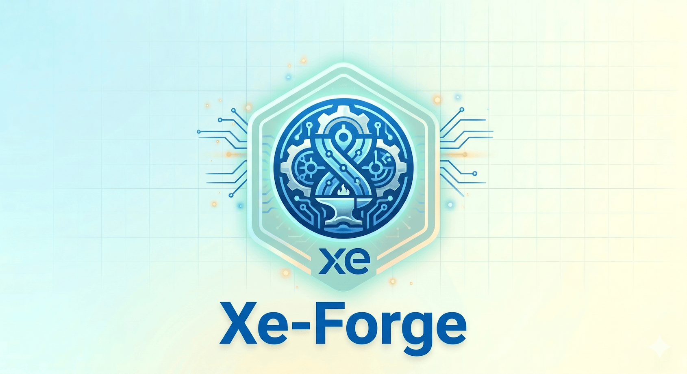
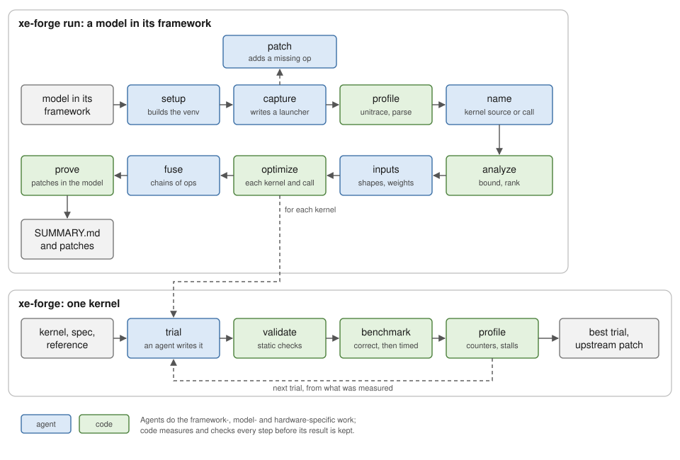
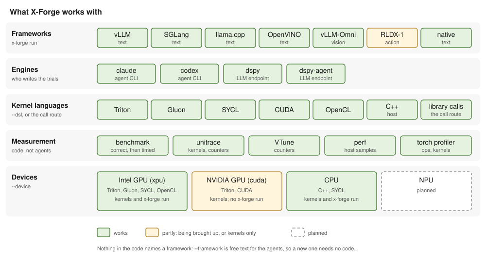

<p align="center">
  
</p>

# Xe Forge

Agentic kernel optimization for GPUs. Point Xe-Forge at a model in the framework that serves
it, or at a single kernel: LLM agents profile it, find where the time goes, and rewrite the
kernels and library calls behind it, and every change is verified and measured before it
becomes a patch for the upstream project.

[](https://scorecard.dev/viewer/?uri=github.com/IntelLabs/Xe-Forge)

In active development: interfaces change without notice, and it is not meant for production.

## What it does

- **`xe-forge`** takes one kernel and returns an optimized kernel, or a patch to the
  repository the kernel lives in.
- **`xe-forge run`** takes a model in the framework that serves it and returns a patch per
  kernel worth optimizing, and a summary of every kernel the model ran.

<p align="center">
  
</p>

Blue steps are agents and green steps are code: agents do the framework-, model- and
hardware-specific work, and code measures and checks each step before its result is kept.

## Install

```sh
git clone https://github.com/IntelLabs/Xe-Forge.git && cd Xe-Forge
uv sync --extra intel        # or --extra nvidia
cp .env.example .env         # the LLM endpoint and engine
```

## Example

```sh
# One kernel
xe-forge -i examples/gemm/14_Gemm_Divide_Sum_Scaling.py \
         -s examples/gemm/14_Gemm_Divide_Sum_Scaling.yaml -o optimized.py

# A model in its framework
xe-forge run --framework <name> --model <hub id or path> \
    --batch 4 --input-len 512 --output-len 32 --kernel-repos <repos> -o runs/<name>
```

## Optimize a kernel

The input is a kernel file with a `Model` class, a YAML spec of the shapes to time it at,
and optionally a PyTorch reference that defines what correct means.

| Engine | What runs |
|---|---|
| `dspy` (default) | a staged pipeline of LLM calls, one stage per kind of optimization |
| `claude`, `codex` | an agent CLI in a generated workspace, trial by trial |
| `dspy-agent` | the same workspace, driven by a DSPy agent |

DSLs: `triton`, `gluon`, `sycl`, `cuda`, `opencl`. Every trial must pass the correctness check
and the benchmark before it counts. With `--kernel-repo` the agent works on a kernel inside
another repository and writes the patch back to it.

See [docs/KERNEL.md](docs/KERNEL.md).

## Optimize a model in its framework

Agents do the framework-, model- and hardware-specific work; code measures and checks it.

1. **setup**: an agent builds the framework's environment (or pass `--framework-python`).
2. **capture**: an agent writes a launcher; the run is profiled with unitrace.
3. **patch**: if the framework lacks an op the model needs, an agent adds it and the patch is
   checked against a reference.
4. **name**: an agent finds each op's kernel source, or the library call that runs it.
5. **analyze**: code bounds each kernel and ranks them by recoverable device time.
6. **inputs**: an agent chooses the shapes each kernel is timed at, and their weights.
7. **optimize**: Xe-Forge works on each chosen kernel, and on the call that launches it.
8. **fuse** (`--fuse`): chains of ops one kernel could replace.
9. **prove** (`--prove`): the patches measured together in the model.

Workloads: `text` (prefill and decode), `vision` (denoising steps), `action` (a robot policy).

See [docs/FRAMEWORK.md](docs/FRAMEWORK.md) and the [per-framework pages](docs/frameworks/README.md).

## Tools

`xe-forge-skill` holds the tools the agents call, each usable on its own:
`analyze`, `validate`, `benchmark`, `trial`, `profile`, `upstream`, `capture`, `patch`,
`bound`, `inputs`, `fuse`. See [docs/REFERENCE.md](docs/REFERENCE.md).

## What it works with

<p align="center">
  
</p>

The per-framework pages are in [docs/frameworks/](docs/frameworks/README.md).

## Requirements

- Python 3.11 or newer.
- A GPU with its driver and the matching PyTorch build.
- An LLM endpoint (`dspy`, `dspy-agent`), or the `claude` or `codex` CLI (those engines).
- For `xe-forge run`: the `claude` or `codex` CLI, unitrace, and for counters the metrics library
  ([docs/PROFILING.md](docs/PROFILING.md)).

## Documentation

| Page | For |
|---|---|
| [KERNEL.md](docs/KERNEL.md) | optimizing one kernel: inputs, spec, engines, correctness, port-back |
| [FRAMEWORK.md](docs/FRAMEWORK.md) | `xe-forge run`: steps, workloads, the launcher contract, resuming |
| [frameworks/](docs/frameworks/README.md) | the command and notes for each framework |
| [REFERENCE.md](docs/REFERENCE.md) | every flag and environment variable |
| [PROFILING.md](docs/PROFILING.md) | unitrace, counters, VTune |
| [DSL.md](docs/DSL.md) | adding a DSL |
| [EXAMPLES.md](docs/EXAMPLES.md) | the example kernels |

## Publication

[arXiv:2605.26118](https://arxiv.org/abs/2605.26118) describes an earlier version of the
kernel pipeline; its measurements and citation are in [docs/RESULTS.md](docs/RESULTS.md).

## Contributing and license

See [CONTRIBUTING.md](CONTRIBUTING.md). Released under the [Apache License 2.0](LICENSE).
