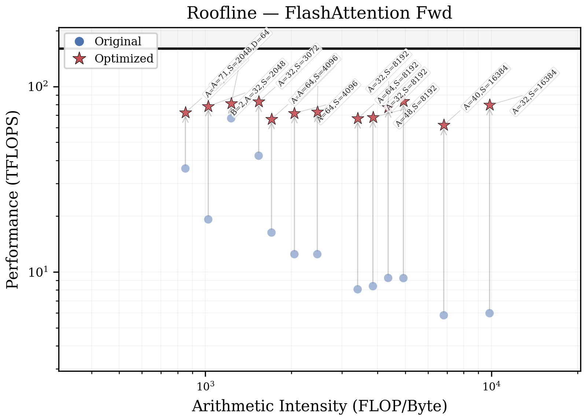
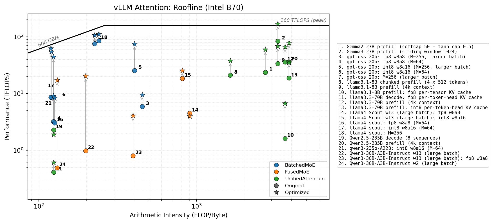
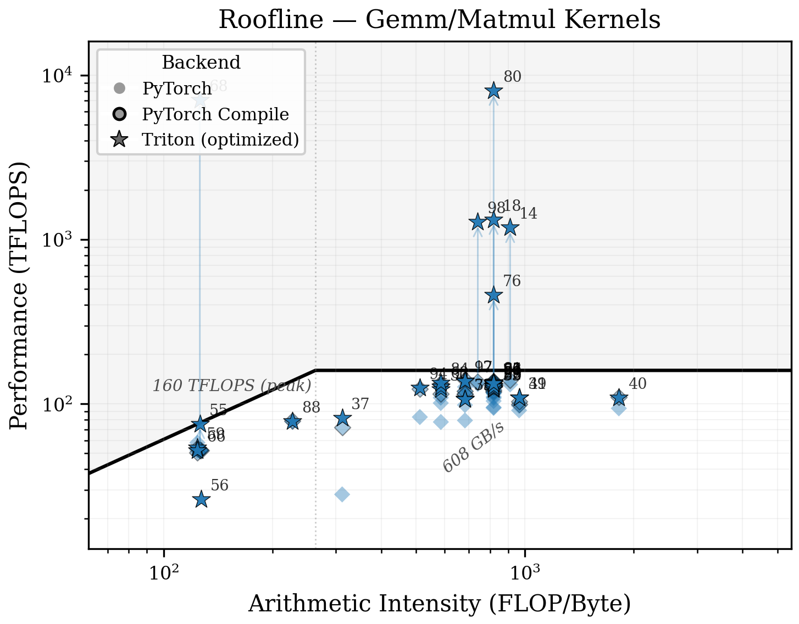

# Results

Measurements of X-Forge (published as Xe-Forge) on an Intel Arc Pro B70. The paper,
[Xe-Forge: Multi-Stage LLM-Powered Kernel Optimization for Intel GPU](https://arxiv.org/abs/2605.26118)
(arXiv:2605.26118), describes an earlier version of the kernel pipeline: its architecture, the
Chain-of-Verification-and-Refinement (CoVeR) agent design and the Intel GPU knowledge base, with
an evaluation on KernelBench Level-2 kernels and Flash Attention.

## FlashAttention forward

FlashAttention benchmark optimized across diverse shapes including skinny, non-square, and
irregular configurations (varying head counts, sequence lengths, and head dimensions). Up to
**13.3x** speedup over unoptimized Triton kernels, with optimized kernels reaching over
**80 TFLOPS** on Intel Arc Pro B70.

<p align="center">
  
</p>

## vLLM attention

Three attention variants from [vLLM](https://github.com/vllm-project/vllm) -- `BatchedMoE`,
`FusedMoE`, and `UnifiedAttention` -- optimized across 24 real-world attention configurations
drawn from production models (Gemma2/3-27B, gpt-oss 20B, Llama3.1-8B, Llama3.3-70B, Llama4
Scout, Qwen2.5/3), covering prefill, decode, chunked prefill, sliding-window, and fp8/int8
KV-cache and weight-quantized setups. Each configuration's original kernel (circle) is lifted
to its X-Forge-optimized counterpart (star), for a **geometric-mean 2.8x speedup** across the
suite. Relative gains are largest on memory-bound configs lifted off near-zero baselines (up to
**35x** for Qwen3-30B-A3B-Instruct), while the highest absolute throughput comes from the
compute-bound Gemma3-27B prefill kernel, which reaches the **160 TFLOPS** peak on Intel Arc Pro
B70. Marker numbers map to the configurations listed in the legend. The kernel specs are in
[examples/vllm](../examples/vllm/).

<p align="center">
  
</p>

## GEMM / Matmul kernels (KernelBench L2)

[KernelBench](https://github.com/ScalingIntelligence/KernelBench) L2 GEMM and Matmul problems.
Optimized Triton kernels surpass both PyTorch eager and `torch.compile` baselines, exceeding the
**160 TFLOPS** peak roofline ceiling for compute-bound configurations.

<p align="center">
  
</p>

## Vision models

Ten diffusion models captured, named, analyzed, optimized and proved under vLLM-Omni with
`x-forge run --workload vision`. Three had no pipeline in the framework at all; three needed a
missing XPU op first. Each kernel was kept only if it was faster and `torch.allclose` against
the baseline at the spec's tolerance.

| model (type) | fits one card | Omni | diffusers | missing | speedup vs reference (diffusers / pytorch) | kernels optimized | kernel opt speedup | overall speedup vs reference |
|---|---|---|---|---|---|---|---|---|
| FLUX.2-klein-9B (image, DiT 9B) | V (fp8) | V | V | — | — | `mha_varlen_fwd` (1.25x) | 1.019x | 1.019x |
| FLUX.2-klein-4B-edit (image+input, DiT) | V (fp8) | V | V | — | — | `mha_varlen_fwd` (1.12x) | 1.009x | 1.009x |
| SDXL-base (image, UNet/CNN) | V | V | V | — | — | GEMM (1.03x), `mha_varlen_fwd` (1.07x) | 1.016x | 1.016x |
| LTX-2.3-Distilled (video, DiT) | layerwise offload | V | V | — | — | `mha_varlen_fwd` (1.21x) | 1.013x | 1.013x |
| Z-Image-Turbo (image, DiT) | V | V | V | ops: `norm`, `rope` (XPU) | 1.419x | `mha_varlen_fwd` (1.11x), `apply_rotary_emb` (1.04x), GEMM (1.00x) | 1.007x | 1.43x |
| Qwen-Image (image, DiT 20B) | layerwise offload | V | V | op: `rope` (XPU) | 1.043x | `mha_varlen_fwd` (1.20x) | 1.007x | 1.05x |
| Wan2.2-TI2V-5B (video, DiT 5B) | V | V | V | ops: `norm`, `rope` (XPU) | 1.125x | `mha_varlen_fwd` (1.11x), `rms_norm_kernel` (1.08x), GEMM (1.02x) | 1.033x | 1.16x |
| PixArt-Sigma (image, DiT) | V | X | V | pipeline (6 files) | 1.046x | `mha_varlen_fwd` (1.94x), GEMM (1.00x), `_sdpa_attention` (1.00x) | 1.286x | 1.35x |
| CogVideoX-2B (video, DiT) | V | X | V | pipeline (7 files) | 1.042x | `mha_varlen_fwd` (1.24x) | 1.115x | 1.16x |
| HunyuanVideo (video, DiT 13B) | model offload | X | V | pipeline (7 files) | 1.155x | `mha_varlen_fwd` (1.15x), GEMM (1.06x), `_move_params` (6.77x) | 1.096x | 1.27x |

- fits one card: the Arc Pro B70's 31.9 GiB. V = one card at the served precision, no
  offload; otherwise the technique that made it fit.
- The reference depends on what was missing. A missing pipeline is measured against diffusers:
  warm generation, model loaded, median of requests 2-4. A missing op is measured against the
  framework's own plain-torch path (`custom_ops ["none"]`). Where nothing was missing the
  unpatched framework is the reference, so the overall figure is the kernel work alone.
- overall = the two speedups multiplied.

## Citation

```bibtex
@article{spoczynski2026xeforge,
  title={Xe-Forge: Multi-Stage LLM-Powered Kernel Optimization for Intel GPU},
  author={Spoczynski, Marcin and Fleischer, Daniel and Berchansky, Moshe and
          Stan, Gabriela Ben-Melech and Guskin, Shira and Xu, Weilin and
          Siemieniuk, Adam and Heinecke, Alexander},
  journal={arXiv preprint arXiv:2605.26118},
  year={2026},
  doi={10.48550/arXiv.2605.26118}
}
```
